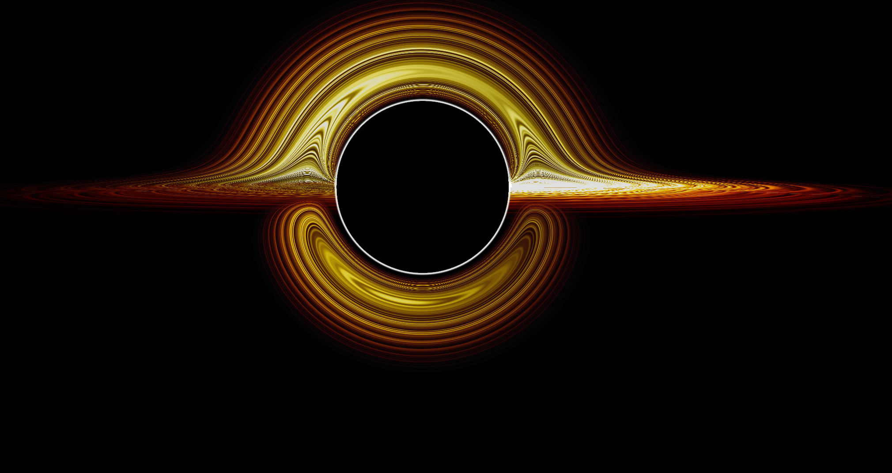

# Kerr-Relativistic-Engine-V-1.1-PRIME

An interactive real-time astrophysics simulation and WebGL raymarching engine modeling gravitational lensing, relativistic Doppler beaming, and spacetime geometry around supermassive black holes and compact celestial bodies.

[](https://ai.studio/apps/dd8cecee-f074-4bcb-89df-2b44c3417ccb)

---

## Visual Overview



*Real-time raymarching visualization featuring an accretion disk with asymmetric Doppler beaming, an Einstein ring, and an embedding spacetime curvature grid.*

---

## Core Features

- **Relativistic Raymarching:** Calculates curved null geodesics around the photon sphere ($1.5 r_s$) and event horizon shadow in real time.
- **Relativistic Doppler Beaming:** Asymmetrical blueshift/redshift and headlamp effects on the orbiting accretion disk.
- **Celestial Presets:** Switchable profiles including **TON 618** (ultramassive black hole) and **PSR B1919+21** (pulsar with magnetic dipole field lines).
- **Interactive Control Dock:** Real-time parameter tweaking for mass, spin parameter ($a$), disk radius, and orbit controls.
- **Audio Synthesizer:** Relativistic Web Audio API module generating ambient gravitational drones based on camera proximity.

---

## Tech Stack

- **Framework:** React, TypeScript, Vite
- **Graphics & Rendering:** Three.js, Custom GLSL Fragment Shaders
- **Audio:** Web Audio API

---

## Getting Started Locally

### Prerequisites
- Node.js (v18 or newer recommended)
- npm or yarn

### Installation & Run

1. Clone the repository:
   ```bash
   git clone [https://github.com/your-username/Kerr-Relativistic-Engine.git](https://github.com/your-username/Kerr-Relativistic-Engine.git)
   cd Kerr-Relativistic-Engine
   ```

2. Install dependencies:
   ```bash
   npm install
   ```

3. Launch local development server:
   ```bash
   npm run dev
   ```

4. Open `http://localhost:5173` in your browser.

---

## License

This project is licensed under the MIT License - see the [LICENSE](LICENSE) file for details.
