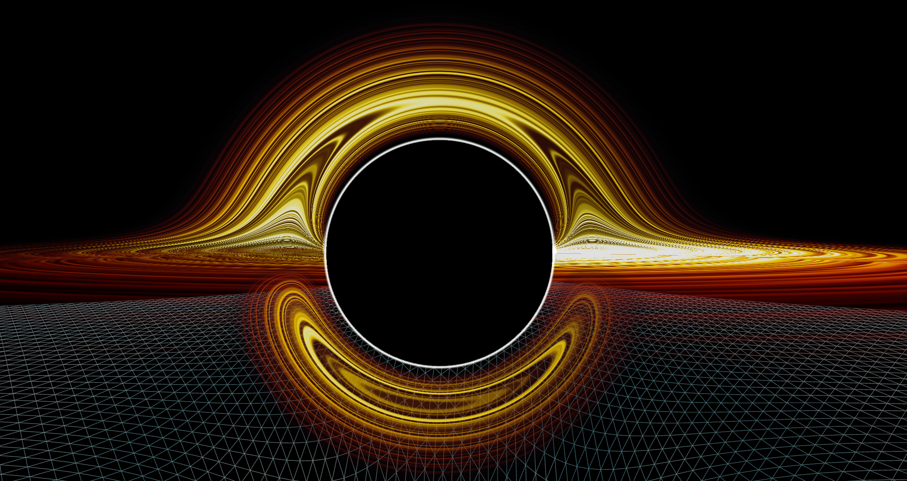
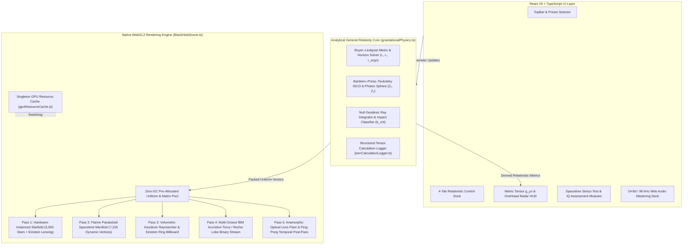

<div align="center">

# Kerr Relativistic Engine · `v1.4 PRIME`

**Production-Grade Real-Time General Relativistic Raymarching, Boyer–Lindquist Spacetime Tensor Simulation & Astrophysical Telemetry Platform**

[](https://ai.studio/apps/dd8cecee-f074-4bcb-89df-2b44c3417ccb)
[](#release-history--changelog)
[](#gpu-shader--rendering-pipeline)
[](#system-architecture)
[](LICENSE)

[**Visual Overview**](#visual-overview) · [**Architecture**](#system-architecture) · [**GPU Shader Pipeline**](#gpu-shader--rendering-pipeline) · [**Mathematical Formulation**](#general-relativistic-mathematical-formulation) · [**Celestial Catalog**](#celestial-catalog--calibrated-presets) · [**Diagnostics & Telemetry**](#diagnostic-stress-tests--telemetry-instrumentation) · [**Quick Start**](#getting-started) · [**Academic References**](#academic-references--citations)

</div>

---

## Overview

**Kerr Relativistic Engine (`v1.4 PRIME`)** is a high-precision, hardware-accelerated astrophysics visualization and numerical relativity platform engineered for the web. Built on a native **WebGL2 / Three.js** pipeline with custom **GLSL raymarching and volumetric shaders**, it solves and renders the exact **Boyer–Lindquist Kerr metric** around rotating black holes, Roche-lobe overflow binary X-ray systems, relativistic pulsars/magnetars, and hypergiant stars at **60–120 FPS**.

Unlike simplified visualizers that rely on static textures or post-process screen-space distortion, **Kerr Relativistic Engine** couples analytical general-relativistic solvers directly to GPU shader uniforms and real-time scientific telemetry overlays—modeling **Bardeen D-shaped event horizon shadows**, **prograde/retrograde ISCO migration**, **Novikov–Thorne radiative blackbody profiles**, **Lense–Thirring frame dragging**, **asymmetric Doppler beaming ($\mathcal{D}^{3+\alpha}$)**, and **Paczyński gravitational microlensing**.

---

## Visual Overview

| **Ultramassive Kerr Quasar (`TON 618` · $6.6 \times 10^{10}\,M_\odot$)** | **Relativistic Doppler Beaming & Flamm Spacetime Manifold** |
| :---: | :---: |
|  |  |
| *Volumetric raymarched Novikov–Thorne accretion disk with primary ($n=1$) and secondary ($n=2$) lensed Einstein arches.* | *Asymmetric approaching/receding Doppler beaming, photon-ring caustics, and dynamically deformed Flamm paraboloid embedding grid.* |

---

## Key Production Capabilities

### 1. Cinematic Deep-Space Helical Boot & Singularity Seed Detonation
- **Multi-Stage IMAX Camera Spline:** Initializes at maximum orbital distance ($r_0 = 260.0\text{ world units} \approx 148.6\,R_s, \theta = 62^\circ, \phi = 132^\circ$) with HUD chrome and grid suppressed for an unobstructed deep-space approach.
- **Autonomous Singularity Ignition:** Glides along a helical arc to a suspended **Singularity Seed** ($r = 95.0$), holds in weightless orbital drift, and automatically triggers a relativistic N-wave shockwave detonation—unfurling the Kerr event horizon, photon ring, accretion disk, and 3D spacetime curvature grid simultaneously.
- **Quintic S-Curve Dolly & Late-Stage HUD Flow:** Executes a 3.2-second quintic smoothstep ($6t^5 - 15t^4 + 10t^3$) spherical dolly pan into the canonical observer lock ($r = 16.5\,R_s, \theta = 71^\circ, \phi = 96^\circ$) with dynamic FOV breathing, revealing the UI HUD only as the camera settles.

### 2. Dual Accretion Rendering Modes & 4 Spectral Calibration Channels
- **Rendering Architecture:** Instant switching between **Classic Multi-Layer Volumetric Torus** and **Full-Screen Billboard Volumetric Geodesic Raymarcher**.
- **Multi-Band Spectral Filters:**
  - **Optical Blackbody (`blackbody`):** True Novikov–Thorne radial temperature gradient ($10^5\text{ K} \to 10^7\text{ K}$).
  - **Event Horizon Telescope (`eht230ghz`):** $230\text{ GHz}$ ($1.3\text{ mm}$) interferometric synchrotron false-color palette matching M87\* and Sgr A\* reconstructions.
  - **Chandra X-Ray (`xray`):** High-energy coronal Bremsstrahlung and $\text{Fe K}\alpha$ ($6.4\text{ keV}$) fluorescence mapping.
  - **Relativistic Velocity Map (`doppler`):** Direct blue/red continuum diagnostic isolating approaching ($+\beta_{\parallel}$) vs. receding ($-\beta_{\parallel}$) Keplerian plasma shear.

### 3. Side-by-Side Synchronized Compare Viewport
- Dual-canvas WebGL2 split-screen mode enabling real-time comparative astrophysics between any two celestial presets or one-click **Kerr Spin Contrast** benchmarks ($a^* = 0.000$ Schwarzschild vs. $a^* = 0.998$ Near-Extremal Kerr) with synchronized camera quaternions and live ISCO/ergosphere differentials.

### 4. 24-Bit / 96 kHz Hi-Res Procedural Audio Mastering Deck
- Custom polyphonic Web Audio synthesizer featuring **5 procedural interstellar scores** (*Gargantua Organ Cathedral*, *Event Horizon Noir*, *Singularity Pulse*, *Lense–Thirring Drift*, *Hawking Whisper*), a real-time 60 FPS **FFT Spectrum & Waveform Analyzer**, **3-Band Mastering EQ** (Sub-Bass, Presence, Air), stereo widener, and camera-distance-coupled gravitational redshift low-pass filtering.

### 5. Three Bespoke Scientific UI Themes
- **Kerr Engine Claude (`kerr_claude`):** Warm obsidian glass (`#0b0a09`) with terracotta-amber (`#d97757`) accents and high-legibility parchment typography.
- **Event Horizon Noir (`horizon_noir`):** Deep-space OLED carbon (`#05070e`) with Cherenkov cyan (`#38bdf8`) and mission-control telemetry contrast.
- **Aethelgard Alabaster (`aethelgard_light`):** Daylight editorial laboratory paper (`#f6f4ef`) with crisp slate ink and warm bronze instrumentation.

---

## System Architecture



### Repository Structure

```text
├── public/
│   └── assets/                         # High-DPI simulation captures & OpenGraph assets
├── src/
│   ├── components/
│   │   ├── TopBar.tsx                  # Preset switcher, Compare toggle, Video Recorder & v1.4 Changelog pill
│   │   ├── ControlDock.tsx             # 4-tab parameter dock (Spacetime, Spectral, Camera, Geodesics)
│   │   ├── SettingsModal.tsx           # Graphics, UI Themes, 96kHz Audio Deck, IQ Test & Stress-Test Diagnostics
│   │   ├── IQTestModule.tsx            # 10-question General Relativity & Astrophysics cognitive assessment
│   │   ├── KerrEngineLogViewer.tsx     # Tensor calculation log archive & interactive terminal replay
│   │   ├── ChangelogModal.tsx          # Terminal-style engine milestone viewer (v1.2 – v1.4 PRIME)
│   │   ├── MetricTelemetryOverlay.tsx  # Live Boyer–Lindquist metric tensor g_μν & Kretschmann scalar HUD
│   │   ├── PerformanceMonitorOverlay.tsx # Real-time GPU pass profiler, frame-time histogram & VRAM monitor
│   │   ├── OverheadMapWidget.tsx       # 2D equatorial polar radar tracking S2 star & live photon rays
│   │   ├── BlackHoleAnatomyOverlay.tsx # 3D-projected anatomical callouts & leader lines
│   │   ├── CompareModeOverlay.tsx      # Dual-viewport spin contrast & differential metric header
│   │   ├── CosmicScaleModal.tsx        # Logarithmic horizon size comparator (Solar System vs. TON 618)
│   │   ├── ArchetypeExplorerModal.tsx  # Taxonomic encyclopedia of relativistic compact objects
│   │   ├── PhysicsModal.tsx            # Effective potential V_eff(r) curves & CSV export portal
│   │   └── QuickGuideModal.tsx         # Plain-English illustrated guide to relativistic optics
│   ├── hooks/
│   │   ├── useHaptics.ts               # Web Vibration API tactile feedback synthesizer
│   │   └── useViewportCategory.ts      # Responsive desktop / tablet / mobile layout detector
│   ├── i18n/
│   │   └── translations.ts             # Multi-language localization dictionary (EN, ES, FR, DE, JA, ZH)
│   ├── physics/
│   │   ├── gravitationalPhysics.ts     # Exact Kerr metric solver, presets, geodesics & CSV serializer
│   │   ├── kerrCalculationLogger.ts    # Multi-tier numerical tensor log generator (Standard / Deep / Extreme)
│   │   └── compactStarShaders.ts       # Neutron star crust, dipole precession & synchrotron beam GLSL shaders
│   ├── scene/
│   │   ├── BlackHoleScene.ts           # Core WebGL2 Three.js engine, GLSL raymarcher & camera choreography
│   │   └── gpuResourceCache.ts         # Singleton geometry/texture/shader pool for zero-GC transitions
│   ├── utils/
│   │   └── relativisticAudio.ts        # Polyphonic Web Audio synthesizer & 24-bit/96kHz mastering chain
│   ├── App.tsx                         # Root application state orchestrator & keyboard shortcut controller
│   ├── index.css                       # Theme token variables & scientific UI styling
│   └── main.tsx                        # React 19 DOM entry point
├── index.html                          # HTML5 entry point with typography preconnects
├── package.json                        # Dependencies & build scripts
├── tsconfig.json                       # Strict TypeScript 5.8 configuration
└── vite.config.ts                      # Vite 8 bundler configuration
```

---

## GPU Shader & Rendering Pipeline

The rendering engine (`src/scene/BlackHoleScene.ts`) is architected around **zero per-frame heap allocations** and **IEEE-754 NaN/Inf fragment guards** across 7 specialized GPU passes:

| Pass | Shader / Mesh Layer | Mathematical & Visual Responsibility | GPU Cost Tier |
| :---: | :--- | :--- | :---: |
| **1** | **Deep-Space Starfield** (`InstancedMesh` · 5,500 stars) | Evaluates Harvard B–V blackbody colors, per-star scintillation, and $O(1)$ vertex-stage Einstein deflection $\Delta\theta = \frac{4GM}{c^2 b}$ with shockwave refraction. | `LOW` (~5%) |
| **2** | **Flamm Paraboloid Manifold** (`84×84` polar-indexed grid) | Deforms radial proper distance $d\rho = dr/\sqrt{1 - R_s/r}$, applies Lense–Thirring azimuthal frame-dragging twist, and propagates concentric N-wave ripples. | `MODERATE` (~8%) |
| **3** | **Volumetric Geodesic Raymarcher** (`Billboard Quad` · GLSL) | Raymarches curved photon trajectories in Boyer–Lindquist coordinates; synthesizes Bardeen D-shaped shadow, $n=1$ Einstein arches, and $n=2$ photon-ring caustics. | `HIGH` (~32–44%) |
| **4** | **Relativistic Accretion Torus** (`Multi-Layer 3D Torus`) | Computes Novikov–Thorne radial temperature, 4-octave 3D gyroid fBM turbulence, Keplerian spiral shear, and $\mathcal{D}^{3+\alpha}$ Doppler beaming. | `HIGH` (~28%) |
| **5** | **Roche-Lobe Binary Stream** (`Teardrop Star + 560 Parcels`) | Deforms companion star photosphere toward Lagrange point $L_1$, advects 560 instanced plasma parcels along a cubic Bézier curve, and renders disk impact shock. | `MODERATE` (~10%) |
| **6** | **Camera-Space Anamorphic Flare** (`Full-Screen NDC Quad`) | Projects prograde Doppler hotspot into NDC space; renders 5-element hexagonal iris ghosts, chromatic dispersion ring, and 12-ray diffraction starburst. | `MODERATE` (~12%) |
| **7** | **Temporal Post-Processor** (`Ping-Pong RGBA8 Targets`) | Executes 9-tap directional velocity chromatic blur during rapid camera slews and multi-frame exponential accumulation in **Time-Lapse Exposure Mode**. | `LOW–HIGH` (Standby / Active) |

---

## General Relativistic Mathematical Formulation

All telemetry readouts and shader uniforms are computed from analytical expressions in **Boyer–Lindquist coordinates** $(t, r, \theta, \phi)$ with metric signature $(-, +, +, +)$ and gravitational radius $r_g = \frac{GM}{c^2} = \frac{1}{2}R_s$:

### 1. Exact Kerr Metric Tensor ($g_{\mu\nu}$)
With $\Sigma = r^2 + a^2\cos^2\theta$ and $\Delta = r^2 - 2Mr + a^2$ (where $a = a^* r_g$):

$$ds^2 = -\left(1 - \frac{2Mr}{\Sigma}\right)dt^2 - \frac{4Mra\sin^2\theta}{\Sigma}dt\,d\phi + \frac{\Sigma}{\Delta}dr^2 + \Sigma\,d\theta^2 + \left(r^2 + a^2 + \frac{2Mra^2\sin^2\theta}{\Sigma}\right)\sin^2\theta\,d\phi^2$$

### 2. Event Horizons, Ergosphere & Frame-Dragging Angular Velocity
- **Outer Event Horizon ($r_+$) & Inner Cauchy Horizon ($r_-$):**
  $$r_{\pm} = r_g\left(1 \pm \sqrt{1 - (a^*)^2}\right)$$
- **Static Limit / Ergosphere Boundary ($g_{tt} = 0$):**
  $$r_{\text{ergo}}(\theta) = r_g\left(1 + \sqrt{1 - (a^*)^2\cos^2\theta}\right)$$
- **Lense–Thirring Frame-Dragging Rate ($\omega$):**
  $$\omega(r, \theta) = -\frac{g_{t\phi}}{g_{\phi\phi}} = \frac{2Mra}{(r^2 + a^2)^2 - a^2\Delta\sin^2\theta}$$

### 3. Bardeen–Press–Teukolsky ISCO & Photon Sphere
- **Equatorial Photon Circular Orbit ($r_{\text{ph}}$):**
  $$r_{\text{ph}} = 2\,r_g\left[1 + \cos\left(\frac{2}{3}\arccos(\mp a^*)\right)\right]$$
- **Innermost Stable Circular Orbit ($r_{\text{ISCO}}$):**
  $$Z_1 = 1 + \left(1 - (a^*)^2\right)^{1/3}\left[(1 + a^*)^{1/3} + (1 - a^*)^{1/3}\right], \qquad Z_2 = \sqrt{3(a^*)^2 + Z_1^2}$$
  $$r_{\text{ISCO}} = r_g\left(3 + Z_2 \mp \sqrt{(3 - Z_1)(3 + Z_1 + 2Z_2)}\right)$$

### 4. Kretschmann Curvature Invariant ($K$)
To verify absence of coordinate pathologies across horizons and stress-test near-extremal spin states, the engine evaluates the exact Kerr Kretschmann scalar:

$$K = R_{\alpha\beta\gamma\delta}R^{\alpha\beta\gamma\delta} = \frac{48\,M^2}{\Sigma^6}\left(r^6 - 15a^2r^4\cos^2\theta + 15a^4r^2\cos^4\theta - a^6\cos^6\theta\right)$$

### 5. Novikov–Thorne Disk Temperature & Relativistic Doppler Factor ($\mathcal{D}$)
- **Effective Blackbody Temperature Profile:**
  $$T_{\text{eff}}(r) = \left[\frac{3GM\dot{M}}{8\pi\sigma_{\text{SB}}r^3}\left(1 - \sqrt{\frac{r_{\text{ISCO}}}{r}}\right)\right]^{1/4}$$
- **Relativistic Doppler Beaming Factor:**
  $$\mathcal{D} = \frac{1}{\gamma\left(1 - \beta\cos\theta_{\text{los}}\right)}\sqrt{1 - \frac{R_s}{r}}, \qquad I_{\text{obs}}(\nu_{\text{obs}}) = \mathcal{D}^{3+\alpha}\,I_{\text{emit}}(\nu_{\text{emit}})$$

---

## Celestial Catalog & Calibrated Presets

The engine ships with **15 astrophysically calibrated presets** spanning 11 orders of magnitude in mass ($1.0\,M_\odot \to 6.6 \times 10^{10}\,M_\odot$). Non-accreting isolated stars and pulsars automatically disable the accretion disk layer, while active binary and circumstellar systems enable their physically appropriate disk/outflow geometry:

| Preset ID | Name | Classification | Mass ($M_\odot$) | Spin ($a^*$) | Default Disk | Physical Signature |
| :--- | :--- | :--- | :---: | :---: | :---: | :--- |
| `ton618` | **TON 618** | Ultramassive Quasar BH | $6.6 \times 10^{10}$ | `0.980` | Active | $3.9 \times 10^{11}\text{ km}$ ($2,600\text{ AU}$) shadow diameter |
| `m87` | **M87\*** | Supermassive Galactic BH | $6.5 \times 10^{9}$ | `0.900` | Active | Messier 87 core; EHT $230\text{ GHz}$ benchmark target |
| `sgra` | **Sagittarius A\*** | Supermassive Galactic BH | $4.3 \times 10^{6}$ | `0.940` | Quiescent | Milky Way nuclear SMBH with S2 star orbit |
| `gw190521` | **GW190521** | Intermediate Merger BH | $142$ | `0.720` | Active | Heaviest LIGO–Virgo–KAGRA binary coalescence remnant |
| `gw150914` | **GW150914** | Stellar Binary Merger BH | $62.0$ | `0.680` | Quiescent | First direct gravitational-wave detection remnant |
| `cygnus_x1` | **Cygnus X-1** | High-Mass X-Ray Binary BH | $21.2$ | `0.998` | Active (Binary) | Near-extremal spin fed by O9.7 Iab supergiant wind |
| `v404_cygni` | **V404 Cygni** | Low-Mass X-Ray Binary BH | $9.0$ | `0.850` | Active (Binary) | Roche-lobe overflow microquasar with Eddington flares |
| `psr_b1919` | **PSR B1919+21** | Radio Pulsar (Neutron Star) | $1.40$ | `0.150` | Disabled | $1.337\text{ s}$ period; dipole magnetosphere & radio cones |
| `magnetar_sgr`| **SGR 1806-20** | Hyper-Magnetic Magnetar | $1.80$ | `0.320` | Fallback Ring | $10^{15}\text{ G}$ crustal field with X-ray fallback debris |
| `rx_j1856` | **RX J1856.5-3754**| Isolated Neutron Star | $1.50$ | `0.120` | Disabled | Magnificent Seven thermal X-ray surface ($R_\infty > R$) |
| `ztf_j1901` | **ZTF J1901+1458** | Ultra-Massive White Dwarf | $1.35$ | `0.280` | Disabled | Near-Chandrasekhar limit ($R \approx 4,280\text{ km}$) |
| `eta_carinae` | **Eta Carinae A** | Luminous Blue Variable | $100$ | `0.680` | Circumstellar | Super-Eddington wind + equatorial Homunculus torus |
| `r136a1` | **R136a1** | Wolf–Rayet Hypergiant | $215$ | `0.620` | Disabled | $8.7 \times 10^6\,L_\odot$; intense UV radiation-driven wind |
| `betelgeuse` | **Betelgeuse** | Red Supergiant ($\alpha$ Ori) | $16.5$ | `0.180` | Disabled | Giant convective boiling cells ($R \approx 764\,R_\odot$) |
| `sol_sun` | **Sol (The Sun)** | G2V Main-Sequence Star | $1.00$ | `0.050` | Disabled | Weak-field hydrostatic reference ($R_s \approx 2.95\text{ km}$) |

---

## Diagnostic Stress Tests & Telemetry Instrumentation

### 1. Automated Spacetime Curvature Stress-Test Suite (`Settings → Diagnostic`)
When the **Diagnostic** tab is opened, the engine automatically sequences through **5 extreme spacetime curvature stress tests** (`SPACETIME_CURVATURE_STRESS_TESTS`), applying each parameter regime to the live 3D WebGL2 engine, triggering an event-horizon shockwave, computing a multi-step **Boyer–Lindquist Tensor Run (`KerrEngineRunLog`)**, and archiving the results to the **Kerr Engine Log Viewer**:

1. **Test 01 — Thorne Spin Limit (`a* = 0.998` · `cygnus_x1`):** Verifies absence of naked ring-singularity division-by-zero as $r_+ \to 1.063\,r_g$ and $r_{\text{ISCO}} \to 1.237\,r_g$.
2. **Test 02 — Schwarzschild Degeneracy (`a* = 0.000` · `gw150914`):** Confirms spherical symmetry restoration ($g_{t\phi} = 0$, $r_{\text{ISCO}} = 6.000\,r_g$, $r_{\text{ph}} = 3.000\,r_g$).
3. **Test 03 — Ultramassive Horizon Scaling (`M = 6.6×10¹⁰ M☉` · `ton618`):** Validates IEEE-754 floating-point stability across $R_s = 1.95 \times 10^{11}\text{ km}$.
4. **Test 04 — Super-Eddington Accretion Surge (`ṁ = 2.85` · `v404_cygni`):** Stress-tests ACES filmic tone mapping and volumetric raymarching under extreme radiative flux and $5.0\times$ Flamm funnel depth.
5. **Test 05 — Grazing Photon-Ring Caustic (`i = 86°` · `m87`):** Validates secondary ($n=2$) Einstein arch raymarching and $\mathcal{D}^4$ Doppler beaming at near-equatorial grazing incidence.

### 2. Geodesic CSV Telemetry Export Schema
Launching photon trajectories from the **Geodesics** tab (or via double-click) allows exporting step-by-step integration data as a standard RFC-4180 CSV file with metadata headers:

```csv
# Kerr Relativistic Geodesic Telemetry Export
# Mass_Solar,Spin_a*,Inclination_Deg,EventHorizon_Rg,PhotonSphere_Rg,ISCO_Prograde_Rg
# 6500000000,0.900,17,1.436,1.558,2.321
trajectory_id,outcome,impact_parameter_b_Rs,closest_approach_Rs,deflection_rad,step_index,x_scene,y_scene,z_scene,r_Rs,phi_deg,gravitational_redshift_z
live-geodesic-1,critical-orbit,2.600,1.520,4.8120,0,-24.0000,0.0000,4.5500,13.9421,169.26,0.0379
```

---

## Controls & Keyboard Shortcuts

| Input / Shortcut | Function |
| :---: | :--- |
| **Left-Click + Drag** | Orbit camera in spherical coordinates $(\theta, \phi)$ around primary mass |
| **Scroll Wheel / Pinch** | Dolly zoom along radial coordinate $r \in [3.5, 260.0]$ world units |
| **Double-Click Canvas** | Fire a live null geodesic photon ray at the clicked impact parameter $b$ |
| **Click Central Horizon** | Collapse black hole into a Singularity Seed / Replay relativistic expansion |
| **`Space`** | Skip startup boot intro / Pause or resume simulation time ($\Delta t$) |
| **`H`** | Collapse or expand the bottom Control Dock |
| **`C`** | Toggle **Clean Mode** (hide all HUD overlays for unobstructed 3D capture) |
| **`Esc`** | Exit Clean Mode / Close active modal window |

---

## Getting Started

### System Requirements
- **Node.js:** `v18.0.0` or newer (`v20 LTS` recommended)
- **Package Manager:** `npm v9+` or `pnpm`
- **Browser:** Any modern browser with **WebGL 2.0** hardware acceleration enabled (Chrome, Edge, Firefox, Safari 16+)

### Installation & Local Development

```bash
# 1. Clone the repository
git clone https://github.com/your-username/Kerr-Relativistic-Engine.git
cd Kerr-Relativistic-Engine

# 2. Install dependencies
npm install

# 3. Start the Vite development server on port 3000
npm run dev
```

Open **`http://localhost:3000`** in your browser.

### Available Scripts

| Command | Description |
| :--- | :--- |
| `npm run dev` | Starts the local development server on `http://0.0.0.0:3000` |
| `npm run build` | Compiles production TypeScript & bundles optimized assets into `dist/` |
| `npm run preview` | Serves the production build locally for verification |
| `npm run lint` | Runs strict TypeScript type-checking (`tsc --noEmit`) across the codebase |
| `npm run clean` | Removes build artifacts (`dist/`) |

---

## Academic References & Citations

The physical models, geodesic integrators, and relativistic rendering algorithms implemented in this engine are grounded in the following foundational papers:

1. **Bardeen, J. M., Press, W. H., & Teukolsky, S. A. (1972).** *Rotating Black Holes: Locally Nonrotating Frames, Energy Extraction, and Scalar Synchrotron Radiation.* The Astrophysical Journal, **178**, 347–370. *(ISCO radii $Z_1, Z_2$ and Kerr shadow geometry)*
2. **Novikov, I. D., & Thorne, K. S. (1973).** *Astrophysics of Black Holes.* In *Black Holes (Les Astres Occlus)*, pp. 343–450. *(Relativistic thin-disk radial temperature and radiative efficiency $\eta$)*
3. **Luminet, J.-P. (1979).** *Image of a Spherical Black Hole with Thin Accretion Disk.* Astronomy and Astrophysics, **75**, 228–235. *(Primary and secondary lensed disk images and Doppler asymmetry)*
4. **James, O., von Tunzelmann, E., Franklin, P., & Thorne, K. S. (2015).** *Gravitational Lensing by Spinning Black Holes in Astrophysics, and in the Movie Interstellar.* Classical and Quantum Gravity, **32**(6), 065001. *(Kerr raymarching, camera-space lensing, and Doppler beaming)*
5. **Paczyński, B. (1986).** *Gravitational Microlensing by the Galactic Halo.* The Astrophysical Journal, **304**, 1–5. *(Point-lens microlensing amplification $A(u)$ and doublet image positions)*
6. **Event Horizon Telescope Collaboration (2019 / 2022).** *First M87 Event Horizon Telescope Results. I. The Shadow of the Supermassive Black Hole* & *First Sagittarius A\* Event Horizon Telescope Results. I.* The Astrophysical Journal Letters, **875**(1), L1 & **930**(2), L12. *(230 GHz synchrotron ring calibration)*

---

## License

Distributed under the **MIT License**. See [`LICENSE`](LICENSE) for full license text.
